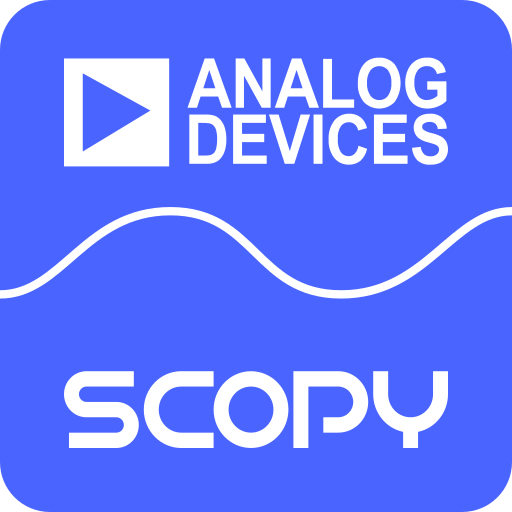
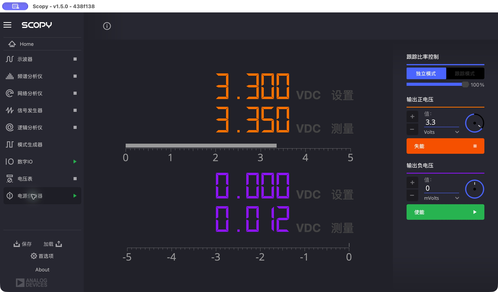

# Scopy 1.5 for Apple Silicon

English | [简体中文](README.md)




An Apple Silicon native port of Scopy 1.5 for macOS users working with the ADALM2000, based on Analog Devices' [Scopy v1.5.0-rc1](https://github.com/analogdevicesinc/scopy/tree/v1.5.0-rc1). This is an unofficial community port and is not an official Analog Devices release.

## Quick start

1. Download `Scopy-v1.5.0-rc1-macOS-arm64.zip` from [Releases](../../releases/latest).
2. Unzip it and drag `Scopy-arm64.app` to Applications.
3. Open Scopy from Applications and connect your ADALM2000.

The app is ad-hoc signed and is not notarized by Apple. macOS may warn that the developer cannot be verified; after confirming the download source, follow the instructions in System Settings → Privacy & Security to allow it to open.

## Interface preview



*Scopy's power supply interface, with instrument names shown in Chinese.*

## Features

- Native Apple Silicon (arm64) support.
- Measurement and analysis with the ADALM2000.
- Chinese interface support, including translated instrument names; some text may remain in English.
- Improved embedded Python path isolation and device reconnection stability.
- Corrected network analyzer script axes.

## How it works

This port adapts Scopy 1.5's source, build configuration and dependencies for macOS, then compiles them natively for Apple Silicon (arm64). The required dynamic libraries, Python runtime and resources are bundled into a standalone macOS application.

## Compatibility

An actual experiment was completed successfully on an **Apple M6 device running macOS 27.0.1**. The build targets macOS 11 and later; compatibility with other devices and macOS versions has not been confirmed.

## Feedback

For problems or compatibility reports, please open an [issue](../../issues) with your Mac model, chip, macOS version, device connection and steps to reproduce.

## Build from source

An Apple Silicon Mac, Xcode and its command-line tools, Git, Python 3, and [micromamba](https://mamba.readthedocs.io/en/latest/installation/micromamba-installation.html) are required. With `micromamba` on PATH, run the following from the repository root:

```sh
python3 native/bootstrap.py
MAMBA_ROOT_PREFIX="$PWD/native/mamba" micromamba create -y -p "$PWD/native/env" -f native/environment-explicit.txt
python3 native/build.py
mkdir -p outputs
python3 native/package.py
python3 native/verify.py
```

The build downloads third-party sources and packages; the bootstrap script refuses to overwrite existing source directories. The resulting app is locally ad-hoc signed and has not been notarized by Apple. The release archive contains build paths, and third-party redistribution requirements still need review.

## Project structure

- `source/`: modified Scopy source and iio-emu.
- `native/`: Apple Silicon build scripts, dependency pins and patches.
- `third_party/`: third-party dependency provenance and license materials.

## Credits and licenses

Thanks to the contributors to [Analog Devices Scopy](https://github.com/analogdevicesinc/scopy) and its dependencies. This port is based on upstream commit `438f13835ef65c8ff56a511532817575a04d7fa9`.

Scopy is licensed under [GPL-3.0-or-later](LICENSE). iio-emu is subject to additional [ADI license terms](source/iio-emu/LICENSE_ADIBSD); see [third_party/NOTICES.md](third_party/NOTICES.md) for third-party provenance and license information.
